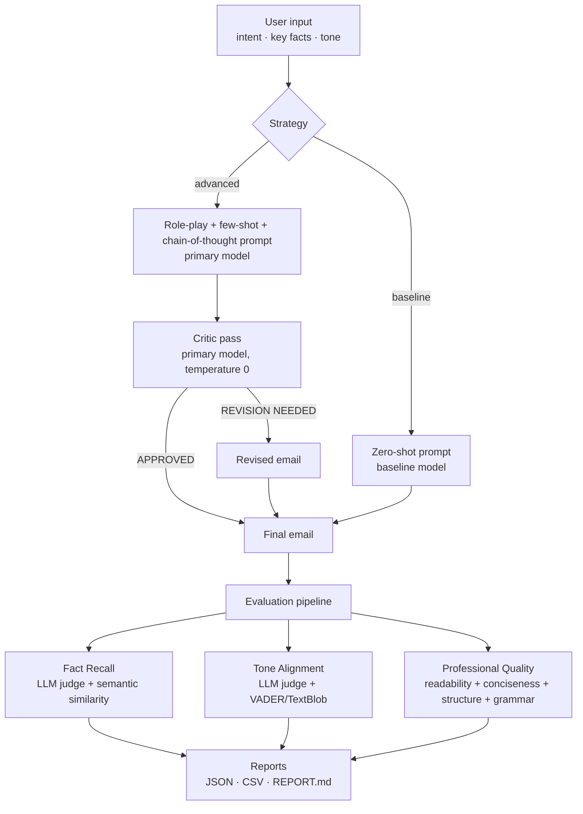

# MailCraft AI

**Generate professional emails with LLMs, then measure how good they actually are.**

MailCraft AI takes three inputs — an **intent**, a list of **key facts**, and a **tone** — and produces a polished, ready-to-send email. What makes it different from a thin "write me an email" wrapper is the second half: a custom evaluation framework that scores every generated email on fact coverage, tone accuracy, and writing quality, so two prompting strategies can be compared with real numbers instead of eyeballing.

Built with **FastAPI**, **LangChain**, and **Streamlit**, running on **OpenAI**, **Groq**, or **Azure OpenAI** (auto-detected from whichever API key you provide).

[](https://github.com/Got950/Email-Generation-Assistant/actions/workflows/ci.yml)


---

## Table of contents

- [Features](#features)
- [How it works](#how-it-works)
- [Tech stack](#tech-stack)
- [Getting started](#getting-started)
- [Configuration](#configuration)
- [Usage](#usage)
  - [REST API](#rest-api)
  - [Streamlit dashboard](#streamlit-dashboard)
  - [Evaluation CLI](#evaluation-cli)
- [Prompting strategies](#prompting-strategies)
- [Evaluation framework](#evaluation-framework)
- [Benchmark scenarios](#benchmark-scenarios)
- [Project structure](#project-structure)
- [Testing and linting](#testing-and-linting)
- [Docker](#docker)
- [Continuous integration](#continuous-integration)
- [Troubleshooting](#troubleshooting)
- [Roadmap](#roadmap)
- [License](#license)

---

## Features

- **Two generation strategies** you can switch between per request:
  - **Advanced** — role-play persona, few-shot examples, chain-of-thought planning, and a self-reflection critic pass that revises the draft if it misses facts or drifts in tone.
  - **Baseline** — a plain zero-shot prompt, used as a comparison point.
- **Three custom evaluation metrics** (each scored 0–100): Fact Recall, Tone Alignment, and Professional Quality. Each one combines an LLM judge with deterministic signals such as semantic similarity, sentiment analysis, readability, and structural checks.
- **Ten benchmark scenarios** covering ten distinct tones, each with a hand-written reference email.
- **Automatic reports** in JSON, CSV, and Markdown. `REPORT.md` is regenerated with real scores on every evaluation run.
- **Multi-provider support** for OpenAI, Groq, and Azure OpenAI, with automatic provider detection and per-role model overrides.
- **Resilience built in**: exponential backoff on rate limits, graceful fallbacks when a judge or the critic returns unusable output, and per-scenario error isolation during evaluation.
- **Streamlit dashboard** for composing emails, running the benchmark with live progress, and exploring results through charts.
- **Production tooling**: Docker and Docker Compose, a GitHub Actions CI pipeline, ruff linting, and 42 mocked unit tests that need no API key.

---

## How it works



A request flows through the system like this:

1. **Input validation.** Pydantic checks the request: the intent must be at least 5 characters and there must be at least one key fact. An empty tone defaults to `professional`.
2. **Generation.** The chosen strategy builds a LangChain `ChatPromptTemplate`, pipes it into the configured chat model, and calls it through `invoke_with_retry`, which backs off exponentially on HTTP 429 errors.
3. **Self-reflection (advanced only).** A critic prompt reviews the draft against the original requirements. If it replies `APPROVED`, the draft is kept. If it replies `REVISION NEEDED`, the revised email is used, but only after passing a sanity check that it looks like a real email. Any critic failure falls back to the original draft.
4. **Evaluation (optional).** The evaluation pipeline scores the email on three metrics and aggregates the results per strategy.

---

## Tech stack

| Layer | Tools |
|-------|-------|
| API | FastAPI, Uvicorn, Pydantic v2, pydantic-settings |
| LLM orchestration | LangChain (`langchain-core`, `langchain-openai`, `langchain-groq`) |
| Model providers | OpenAI, Groq, Azure OpenAI |
| Evaluation | sentence-transformers (`all-MiniLM-L6-v2`), VADER, TextBlob, textstat |
| UI | Streamlit, Plotly |
| Tooling | pytest, pytest-asyncio, ruff, Docker, GitHub Actions |

---

## Getting started

### Prerequisites

- Python **3.11 or newer**
- At least one API key: **OpenAI** (`sk-...`), **Groq** (`gsk_...`), or an **Azure OpenAI** key plus endpoint

### Installation

```bash
git clone https://github.com/Got950/Email-Generation-Assistant.git
cd Email-Generation-Assistant

python -m venv venv
source venv/bin/activate          # Windows: venv\Scripts\activate

pip install -r requirements.txt

cp .env.example .env
# Open .env and add at least one API key
```

> The first evaluation run downloads the `all-MiniLM-L6-v2` sentence-transformer model (about 90 MB). Generation alone does not need it.

### Run it

```bash
# API with Swagger docs at http://localhost:8000/docs
uvicorn app.main:app --reload --port 8000

# Dashboard at http://localhost:8501
streamlit run ui/streamlit_app.py

# Full benchmark (both strategies, all scenarios)
python run_evaluation.py
```

---

## Configuration

All settings are read from environment variables or from a `.env` file in the project root (see `.env.example`).

| Variable | Default | Description |
|----------|---------|-------------|
| `PROVIDER` | `auto` | `auto`, `openai`, `groq`, or `azure` |
| `OPENAI_API_KEY` | — | OpenAI key (must start with `sk-`) |
| `GROQ_API_KEY` | — | Groq key (must start with `gsk_`) |
| `AZURE_OPENAI_API_KEY` | — | Azure OpenAI key |
| `AZURE_OPENAI_ENDPOINT` | — | For example `https://your-resource.openai.azure.com/` |
| `AZURE_OPENAI_API_VERSION` | `2024-08-01-preview` | Azure API version |
| `PRIMARY_MODEL` | per provider | Model used by the advanced strategy and the critic |
| `BASELINE_MODEL` | per provider | Model used by the baseline strategy |
| `JUDGE_MODEL` | per provider | Model used by the evaluation judges |
| `LOG_LEVEL` | `INFO` | Python logging level |

### Provider auto-detection

When `PROVIDER=auto`, the provider is chosen in this order:

1. **OpenAI**, if `OPENAI_API_KEY` starts with `sk-`
2. **Azure**, if both `AZURE_OPENAI_API_KEY` and `AZURE_OPENAI_ENDPOINT` are set
3. **Groq**, if `GROQ_API_KEY` is set
4. Otherwise it falls back to OpenAI, and the app logs a warning that no valid key was found

### Default models

| Role | OpenAI | Groq |
|------|--------|------|
| Primary (advanced strategy and critic) | `gpt-4o` | `openai/gpt-oss-120b` |
| Baseline | `gpt-4o-mini` | `openai/gpt-oss-20b` |
| Judge (evaluation) | `gpt-4o` | `openai/gpt-oss-120b` |

On Azure, the model names are passed as **deployment names**, so set `PRIMARY_MODEL`, `BASELINE_MODEL`, and `JUDGE_MODEL` to match your deployments.

Generation uses temperature `0.7`. The critic and all judges use temperature `0.0` so their verdicts are deterministic.

---

## Usage

### REST API

Interactive docs are served at `http://localhost:8000/docs` (Swagger) and `http://localhost:8000/redoc`.

#### `GET /health`

Reports whether the service is up and which provider it resolved to.

```json
{ "status": "ok", "provider": "openai", "has_valid_key": true }
```

#### `POST /generate`

Generates a single email.

| Field | Type | Required | Notes |
|-------|------|----------|-------|
| `intent` | string | yes | At least 5 characters |
| `key_facts` | string[] | yes | At least one item |
| `tone` | string | yes | Free text. The ten benchmark tones are listed under [Benchmark scenarios](#benchmark-scenarios) |
| `strategy` | string | no | `advanced` (default) or `baseline` |

```bash
curl -X POST http://localhost:8000/generate \
  -H "Content-Type: application/json" \
  -d '{
    "intent": "Follow up after a demo call",
    "key_facts": ["Demo was last Tuesday", "Client liked reporting", "Next step is pilot"],
    "tone": "formal",
    "strategy": "advanced"
  }'
```

Response:

```json
{
  "email": "Subject: Next Steps Following Last Tuesday's Demo\n\nDear Team,\n\n...\n\nBest regards,",
  "model_name": "gpt-4o",
  "strategy": "advanced",
  "was_revised": false
}
```

`was_revised` is `true` when the critic rewrote the first draft.

Error responses:

- `400` for an unknown strategy
- `422` when the request body fails validation (for example, an intent that is too short or an empty `key_facts` list)
- `500` when the LLM call fails

#### `POST /evaluate`

Runs the full benchmark synchronously and returns every per-scenario result along with a summary. Expect it to take several minutes, since each scenario makes multiple LLM calls.

```bash
curl -X POST http://localhost:8000/evaluate \
  -H "Content-Type: application/json" \
  -d '{"strategies": ["advanced", "baseline"]}'
```

The response has this shape:

```json
{
  "results": [
    {
      "scenario_id": 1,
      "intent": "Follow up after a product demo meeting",
      "tone": "formal",
      "strategy": "advanced",
      "model_name": "gpt-4o",
      "generated_email": "Subject: ...",
      "scores": [
        { "metric_name": "Fact Recall", "score": 100.0, "details": "4/4 facts confirmed" },
        { "metric_name": "Tone Alignment", "score": 92.0, "details": "LLM judge: 9/10, ..." },
        { "metric_name": "Professional Quality", "score": 90.0, "details": "Readability: ..." }
      ]
    }
  ],
  "summary": {
    "advanced": { "Fact Recall": 97.5, "Tone Alignment": 88.4, "Professional Quality": 86.0, "overall_average": 90.6 },
    "baseline": { "...": "..." }
  }
}
```

The numbers above only illustrate the format; they are not real benchmark results. This endpoint returns results but does not write report files. To get the files, use the CLI or the dashboard.

### Streamlit dashboard

```bash
streamlit run ui/streamlit_app.py
```

The dashboard calls the generation and evaluation code directly in-process, so the FastAPI server does not need to be running. It has three pages:

- **Generate Email** — fill in a brief, or load one of the benchmark scenarios, then pick a tone and strategy. The result is rendered as an email preview showing the model used, the tone, word count, latency, and a "Critic revised" badge when applicable. From there you can open the email in Gmail or Outlook, copy it, or download it as a `.txt` file. The last 10 generations are kept in session history.
- **Evaluation Dashboard** — run the benchmark with a live progress feed and time estimate. Afterwards you get an overall comparison, per-metric cards with deltas between strategies, a grouped bar chart, a radar chart, a per-scenario chart, and an expandable breakdown of every generated email with its scores. Results can be exported as JSON or CSV.
- **Test Scenarios** — browse and search the benchmark dataset, filter by tone, read the reference emails, and send any scenario to the generator with one click.

The sidebar shows whether an API key is connected, along with the resolved provider and primary model.

### Evaluation CLI

```bash
python run_evaluation.py                          # both strategies
python run_evaluation.py --strategies advanced    # just one strategy
```

The CLI generates and scores every scenario for each requested strategy, then writes:

| File | Contents |
|------|----------|
| `reports/evaluation_results.json` | Metadata, metric definitions, every result, and the summary |
| `reports/evaluation_results.csv` | One flat row per scenario and strategy, including a 150-character email preview |
| `REPORT.md` | A comparative analysis report regenerated from the results |

`REPORT.md` is overwritten on every run.

Some behavior worth knowing:

- If a scenario fails, the error is logged and the run moves on. The run only aborts if every scenario fails.
- There is a 2-second pause between scenarios to stay under provider rate limits.
- Rate-limited calls are retried up to 5 times, with the delay doubling from 3 seconds each time (3s, 6s, 12s, and so on).

---

## Prompting strategies

All prompt templates live in `app/core/prompts.py`.

### Advanced strategy

The advanced strategy layers several techniques. In my testing, stacking them worked noticeably better than any one on its own.

1. **Role-playing.** The system prompt casts the model as a B2B sales communications specialist with 15 years of experience. It also sets hard rules: include every fact, keep the tone consistent, use a greeting, one to three body paragraphs, and a sign-off, keep it concise, never use placeholders like `[Your Name]`, and never output the planning notes.
2. **Few-shot examples.** Three complete example emails (formal demo follow-up, casual re-engagement, empathetic outage apology) give the model a consistent structure to copy. Without them, the output format varies a lot from run to run.
3. **Chain-of-thought planning.** Before writing, the model is told to silently work out the main call to action, decide which paragraph each fact belongs in, and choose vocabulary that fits the tone. This step alone noticeably reduced how often facts were left out.
4. **Self-reflection critic.** A second pass, run at temperature 0, checks the draft for missing facts, tone drift, and missing structural parts. It either replies `APPROVED` or returns a corrected email. Its output is only accepted if it looks like a real email (it has a `Subject:` line or a "regards" sign-off). If the critic returns garbage or errors out, the original draft is kept.

### Baseline strategy

The baseline is a minimal zero-shot prompt: a system message saying "You are a helpful assistant that writes professional emails" and a user message listing the three inputs. There are no examples, no reasoning steps, and no critic pass. It runs on the cheaper baseline model.

---

## Evaluation framework

I didn't use generic metrics like BLEU or ROUGE because they don't capture what matters in a business email. Instead there are three custom metrics, each scored from 0 to 100.

### 1. Fact Recall

*Did the email include every key fact?* (`app/evaluation/metrics/fact_recall.py`)

- **LLM judge:** the judge model is asked about each fact individually, with a YES/NO question that accepts paraphrases.
- **Semantic fallback:** if the judge says NO, the email is split into sentences and each one is embedded with `all-MiniLM-L6-v2`. The fact counts as present if its best cosine similarity to any sentence is at least **0.75**.
- **Score:** `confirmed_facts / total_facts × 100`

The per-fact results record which method confirmed each fact.

### 2. Tone Alignment

*Does the email sound the way it was asked to?* (`app/evaluation/metrics/tone_alignment.py`)

- **LLM judge (80% weight):** rates tone match from 1 to 10 against a rubric.
- **Sentiment signal (20% weight):** starts at 10. VADER's compound score and TextBlob's subjectivity score are compared against a profile for each tone. It loses 3 points if sentiment is below the tone's expected range, 1.5 points if it is above the range, and 1.5 points if the text is too subjective.
  - Example: `urgent` allows a compound score from -0.3 to 0.5, while `warm-grateful` expects 0.3 to 1.0.
  - Tones without a profile get a neutral 7.
- **Score:** `(llm_score × 0.8 + sentiment_signal × 0.2) × 10`

### 3. Professional Quality

*Is the email well written?* (`app/evaluation/metrics/professional_quality.py`)

This metric is the sum of four sub-scores, each worth up to 25 points.

| Sub-score | How it's computed |
|-----------|-------------------|
| Readability | Flesch Reading Ease. A score of 50–70 earns the full 25, and points drop in steps as it moves further from that range. Emails under 20 words get 10. |
| Conciseness | Word count compared with the reference email. A ratio of 0.7–1.3× earns 25, with lower scores the further it strays. With no reference, it gets 15. |
| Structure | Five checks: a subject line, a greeting, at least two paragraph breaks, a sign-off, and no `[placeholder]` text. Each passed check is worth 5 points. |
| Grammar and fluency | The LLM judge gives a 1–10 rating, scaled to 25. |

### Robustness

Every metric handles edge cases explicitly. An empty email scores 0. If a judge's response can't be parsed, a neutral midpoint (5 out of 10) is used instead, and failures in the sentiment or embedding libraries are logged without crashing the run. The `details` string on each score explains exactly how the number was reached.

---

## Benchmark scenarios

`data/scenarios.json` holds 10 scenarios. Each has 4 key facts and a hand-written reference email.

| # | Intent | Tone |
|---|--------|------|
| 1 | Follow up after a product demo meeting | formal |
| 2 | Request proposal details from a potential vendor | professional |
| 3 | Cold outreach to a prospective client about our sales automation tool | friendly-casual |
| 4 | Apologize for a missed project deadline | empathetic |
| 5 | Introduce a new AI-powered feature to existing customers | excited |
| 6 | Schedule a quarterly business review meeting | neutral |
| 7 | Respond to a client's pricing objection | persuasive |
| 8 | Thank a client for referring a new customer | warm-grateful |
| 9 | Escalate an unresolved customer support issue internally | urgent |
| 10 | Re-engage a dormant lead who hasn't responded in 3 months | casual-compelling |

To add your own scenario, append an object with `id`, `intent`, `key_facts` (a non-empty list), `tone`, and optionally `reference_email`. The runner validates the file on load and raises a clear error if a required key is missing.

---

## Project structure

```
MailCraft_AI/
├── app/
│   ├── main.py                     # FastAPI app, lifespan logging, /health
│   ├── config.py                   # Settings, provider auto-detection, model defaults
│   ├── api/
│   │   ├── schemas.py              # Pydantic request/response models
│   │   └── routes/
│   │       ├── generate.py         # POST /generate
│   │       └── evaluate.py         # POST /evaluate
│   ├── core/
│   │   ├── prompts.py              # Advanced, baseline, and critic prompt templates
│   │   ├── chains.py               # Generation logic, critic loop, STRATEGY_MAP
│   │   └── models.py               # Model factory (OpenAI/Groq/Azure) + retry/backoff
│   └── evaluation/
│       ├── metrics/
│       │   ├── fact_recall.py
│       │   ├── tone_alignment.py
│       │   └── professional_quality.py
│       ├── runner.py               # Scenario loading/validation, orchestration, summary
│       └── report.py               # JSON / CSV / REPORT.md writers
├── ui/streamlit_app.py             # Streamlit dashboard
├── data/scenarios.json             # 10 benchmark scenarios with reference emails
├── tests/
│   ├── conftest.py                 # Sets dummy API keys for tests
│   └── test_generate.py            # 42 mocked unit tests
├── reports/                        # Generated evaluation output (git-ignored)
├── .streamlit/config.toml          # Dashboard dark theme
├── .github/workflows/ci.yml        # Lint + test on Python 3.11 and 3.12
├── run_evaluation.py               # Evaluation CLI entry point
├── REPORT.md                       # Comparative analysis (auto-generated)
├── Dockerfile
├── docker-compose.yml
├── pyproject.toml                  # Project metadata, ruff and pytest config
├── requirements.txt
└── .env.example
```

---

## Testing and linting

```bash
pytest tests/ -v -k "not integration"
ruff check app/ tests/
```

The 42 unit tests mock every LLM call, so no API key or network access is needed. They cover:

- **API:** the health endpoint, request validation (empty body, missing or short intent, empty facts), and rejection of unknown strategies
- **Prompts:** every template builds correctly, the advanced prompt includes the few-shot examples and planning instructions
- **Metrics:** edge cases for all three metrics, including empty inputs, unparseable judge output, and short or missing reference emails
- **Critic:** approved drafts, revised drafts, garbage output, and exceptions
- **Data:** the scenario file loads, IDs are unique, tones are diverse, and invalid scenarios are rejected
- **Config:** provider auto-detection, rejection of dummy keys, and default versus explicit model names

---

## Docker

```bash
docker-compose up --build
```

| Service | URL | Command |
|---------|-----|---------|
| `api` | http://localhost:8000 | `uvicorn app.main:app` |
| `ui` | http://localhost:8501 | `streamlit run ui/streamlit_app.py` |

Both services are built from the same image, read the same `.env` file, and mount `./reports` so that evaluation results persist on the host.

To build and run only the API:

```bash
docker build -t mailcraft-ai .
docker run --env-file .env -p 8000:8000 mailcraft-ai
```

---

## Continuous integration

`.github/workflows/ci.yml` runs on every push and pull request to `main`. It tests against Python 3.11 and 3.12, and each run:

1. Installs the dependencies
2. Lints with `ruff check app/ tests/`
3. Runs the unit tests with a dummy OpenAI key

---

## Troubleshooting

| Symptom | Likely cause and fix |
|---------|----------------------|
| `No valid API key detected` at startup, or "No API key" in the dashboard sidebar | Check that `.env` exists in the project root and that the key has the right prefix: `sk-` for OpenAI or `gsk_` for Groq. OpenAI keys containing the word `test` are treated as dummy keys. Restart the app after editing `.env`. |
| The wrong provider is used | With both an OpenAI and a Groq key set, OpenAI wins. Set `PROVIDER=groq` (or `azure`) to force a specific provider. |
| Azure returns 404 or "deployment not found" | Set `PRIMARY_MODEL`, `BASELINE_MODEL`, and `JUDGE_MODEL` to your Azure **deployment** names. |
| Repeated `Rate limited ... retrying` log lines | This is expected on free or low-tier plans. The client retries automatically. For faster runs, use a higher-tier key or evaluate one strategy at a time. |
| The first evaluation run is slow | The sentence-transformer model is downloaded on first use and cached after that. |
| `Scenario N FAILED` in the logs | That scenario is skipped and the rest of the run continues. Check the logged error, which is usually an auth, network, or quota problem. |

---

## Roadmap

Things I'd add with more time:

- **LangGraph agent graph** to replace the single critic pass with a proper Planner → Writer → Critic workflow
- **RAG layer** that pulls company context from a vector store, so emails can reference real products and people
- **Streaming** of tokens to the UI over server-sent events
- **A/B routing** to serve both strategies in production and collect live metrics that confirm the offline evaluation results
- **Async evaluation** that runs scenarios concurrently within provider rate limits

---

## License

MIT
